# IMPAKT

Une boîte à rythme de synthèse : 8 pistes, 47 machines, un séquenceur où chaque pas peut tout changer. Le même moteur
tourne en VST3, en Audio Unit, en application et dans le navigateur, avec la même interface.

L'interface est en anglais : ce manuel cite ses libellés tels qu'ils sont à l'écran. Il va à l'essentiel ; chaque
machine est présentée sur la page [Machines](https://distortedimages-code.github.io/IMPAKT/machines.html), et tout
le détail, réglage par réglage, est dans la [référence](reference.md).

## Prise en main

1. **▶** lance la lecture (Espace dans la page web).
2. Touchez un **pad** pour choisir une piste.
3. Touchez le **logo** sur l'écran pour choisir sa machine ; **‹ ›**, en bas de l'écran, passent d'un preset à l'autre.
4. Touchez des **pas** : chacun devient un trig.
5. **Double-tap** sur un pas : il se lève. Tournez un potard : la valeur ne vaut que pour ce pas (le p-lock).
6. Les pages **TONE**, **MOD** et **FX** règlent la piste ; **MASTR** règle tout le mix.
7. **OPTION › Kits** enregistre le tout.

## La façade

Cinq pages, choisies par les touches de la barre, et un menu :

| Page | Ce qu'on y trouve |
| --- | --- |
| SEQ | la machine (son écran, ses 8 potards, ses presets), les pads, les 16 pas, la rangée TRIG, LEN et SPD, le looper, la gamme |
| TONE | le son de la piste : FILTER, TONE, AMP, BOX, et un visualiseur pour sculpter le spectre à la main |
| MOD | deux LFO et deux suiveurs d'enveloppe par piste |
| FX | les envois de la piste et les quatre retours : REVERB, DELAY, CHORUS, PHASER |
| MASTR | la chaîne du master (EQ, COMP, DRV, GRN, OTT, GLCH), MIX et la sortie |
| OPTION | copier, coller, déplacer ou vider une piste, les kits, Init, Demo, les mises à jour |

**Les LED** ont chacune un sens :

| LED | Sens |
| --- | --- |
| rouge | un trig, la page affichée, la boucle enclenchée |
| vert | la lecture, une piste qui joue, une option active |
| ambre | un p-lock, un changement de son, une piste coupée |

**Les gestes**, au doigt comme à la souris :

| Geste | Effet |
| --- | --- |
| tap sur un pas | pose ou retire un trig |
| double-tap sur un pas (Maj + clic dans le plugin) | le lève pour le p-lock |
| glisser un pas vers le haut ou le bas | ratchets : 2 à 16 coups dans le pas |
| tap sur un pad | à l'arrêt, joue la piste et la choisit ; en lecture, la choisit seulement |
| glisser un pad vers le bas | coupe ou rallume la piste |
| double-tap sur un potard | valeur par défaut (sur un pas levé : retire le lock) |

**Au clavier**, dans la page web (le plugin laisse Espace et les chiffres au logiciel hôte) :

| Touche | Effet |
| --- | --- |
| Espace | lecture, arrêt |
| 1 à 8 | choisir la piste |
| R | REC, enregistrer les gestes |
| K | KEY, les pas deviennent un clavier |
| P | PTN, les patterns |
| L | le looper |
| M | couper la piste |
| Échap | sortir (p-lock, ALL, KEY, PTN, un panneau) |

## Le séquenceur

### Trigs et rangée TRIG

Chaque pas allumé est un **trig**. Sous les pas, la **rangée TRIG** règle comment la piste se déclenche ; c'est elle
qu'on p-locke le plus :

| Réglage | Effet |
| --- | --- |
| NOTE | la hauteur, ±24 demi-tons |
| VEL | la vélocité |
| PROB | la probabilité que le trig joue |
| MICR | le micro-timing : un peu avant ou après la grille |
| RTRG, RCNT | le retrig : sa vitesse (1/8 à 1/256) et son nombre de coups (1 à 16) |
| RVEL | la vélocité des coups du retrig, qui monte ou descend |
| GATE | la durée d'une note tenue, en pas (OFF : jusqu'au trig suivant) |

Sa touche **MORE** ouvre la deuxième page : **RPAN** (le pan de chaque coup, au hasard ou en ping-pong), **JUMP** et
**RNG** (des sauts de transposition), **CURV** (la courbe des roulements), **RTUN** et **RDEC** (la hauteur et le decay
de chaque coup, au hasard ou en boucle).

**RTUN** et **RDEC** se lisent pareil : au milieu, rien ; vers la droite (**RND**), chaque coup tire sa valeur ; vers la
gauche (**LOOP**), chaque pas tire la sienne et la garde, la suite revient à chaque tour du pattern. RTUN suit le carré
du potard : quelques cents près du milieu (une dérive humaine), jusqu'à une octave en butée ; sur une piste qui suit la
gamme, les notes tirées tombent dans la gamme.

### P-lock

Un **double-tap** lève un pas : il sort de la rangée, et les potards n'écrivent plus que pour lui. On peut en lever
plusieurs à la fois. Tous les réglages se p-lockent, y compris la machine, la note et les effets de la piste ; sur un
pas levé, choisir un preset pose tout un son (un *sound lock*).

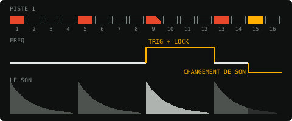

_Un tap sur un pas levé change sa nature. Rouge, c'est un **trig** : il frappe un nouveau coup avec ses réglages. Jaune,
c'est un **changement de son** : pas de nouveau coup, ses réglages arrivent sur le son qui joue déjà (un filtre qui se
ferme sur une queue, une nappe qui change d'accord). Dans les deux cas, le trig suivant reprend les réglages de la
piste._

Pour finir, glissez le pas vers le bas ou touchez **OK**. Un pas qui porte des locks garde un coin noir.

### Roulements : ratchets, retrig, CURV

Glisser un pas vers le haut le découpe en **ratchets**, 2 à 16 coups réguliers dans le pas. Le **retrig** (RTRG, RCNT)
fait la même chose à une vitesse donnée, sur plusieurs pas si besoin. **RVEL** donne la pente de leurs vélocités,
**CURV** leur rythme.

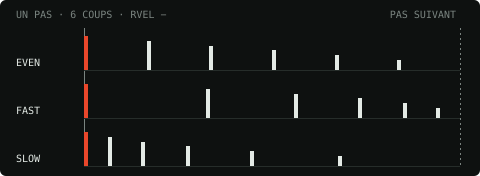

_CURV au milieu (EVEN) : des coups réguliers. Vers FAST, ils se resserrent ; vers SLOW, ils s'écartent, comme une
balle qui rebondit à l'envers. Le dernier coup tombe toujours au même endroit : le roulement reste sur la grille._

### JUMP : une mélodie qui monte toute seule

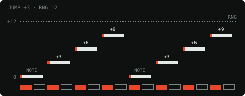

_Chaque trig joue là où en sont les sauts, puis les fait avancer de JUMP. Une fois la plage RNG atteinte, on repart de
la note. Sur une piste qui suit la gamme, JUMP compte en degrés : +2, c'est deux notes de la gamme plus haut. En
p-lock sur un seul pas, seul ce pas bouge, à chaque tour._

### Longueur, vitesse, 64 pas

Chaque piste a sa longueur (**LEN**, 1 à 64 pas) et sa vitesse (**SPD**, de 1/8× à 2×). Les touches **1 2 3 4**
affichent les quatre pages de 16 pas ; un tap sur une page au-delà de la longueur allonge la piste jusque-là. Deux taps
sur une page la copient, trois taps sur une autre page y collent la copie.

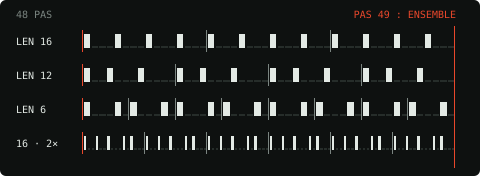

_Des longueurs différentes font des polymétries : une piste de 12 pas contre une de 16 se décale d'un temps à chaque
mesure, et tout retombe ensemble au bout de 48 pas._

## Jouer et arranger

### Patterns et chaînes

Le projet a **128 patterns** (A01 à H16). Un pattern garde, pour chaque piste, son son et ses pas ; le tempo, les
mutes, la gamme et le master sont ceux du projet. La touche **PTN** transforme les pas en patterns et les pads en
banques A à H. Un pattern jamais écrit part des sons de celui d'où l'on vient, sans trig : pratique pour une variation.

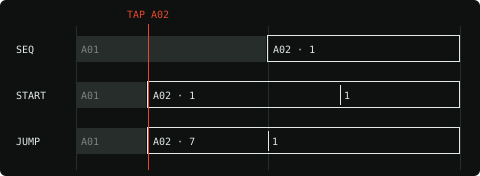

_Un tap sur un pattern le met en attente. **MODE** décide quand il part : **SEQ** à la fin du pattern qui joue (sa
longueur, **CHG**), **START** tout de suite depuis son premier pas, **JUMP** tout de suite là où en est la lecture,
sans perdre la mesure._

**Chain** : touchez des patterns à la suite (jusqu'à 64), puis Chain à nouveau ; la chaîne tourne en boucle.
**Copy**, **Paste** et **Clear** travaillent sur un pattern entier.

### Le looper

La bande **LOOP** replie la lecture sur une fenêtre de la séquence, les 8 pistes ensemble. **LEN** règle sa taille, de
1/128 (un stutter) à 2 mesures ; **POS** la fait glisser en rythme. Un appui maintenu ne boucle que tant qu'on tient.

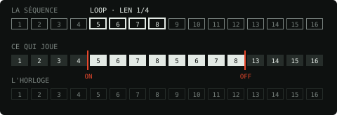

_Sous la boucle, l'horloge continue. Quand on éteint, la lecture retombe là où la séquence en serait : rien ne se
décale._

### REC : enregistrer les gestes

Avec **REC** allumé, pendant la lecture, tourner un potard écrit sa valeur en p-lock sur chaque trig qui passe. Au tour
suivant, le mouvement se rejoue comme une automation. **× Mod** efface les p-locks de la piste (trigs et son restent).

### KEY : jouer au clavier

**KEY** change les 16 pas en clavier pour la piste affichée : une octave de piano, ou 16 notes de la gamme quand la
piste la suit. **− OCT +** décale le clavier. Avec REC en lecture, chaque note jouée est écrite sur le pas qui passe.

### Notes tenues : HOLD et DRONE

En haut de sa course, **DEC** affiche **HOLD** : la note tient tant que son gate est ouvert (le doigt sur le pad, la
note MIDI, ou **GATE** dans le séquenceur), puis s'éteint en un quart de seconde.

**DRONE** (page TONE, module AMP) fait jouer la piste sans trig dès que le transport tourne. Ses trigs ne la frappent
plus : ils la changent (une nouvelle note en legato, un nouvel accord). Un stop ou un mute la relâche.

### ALL : toutes les pistes à la fois

Avec **ALL**, chaque potard agit sur les 8 pistes ensemble, en gardant leurs écarts. Les numéros du bandeau sortent une
piste du mouvement ; **↶ Revert** rend les sons d'avant.

### Copier, déplacer, vider

Dans **OPTION** : **Copy track** et **Paste track** (d'un pattern à l'autre si l'on veut), **Move track** (deux pistes
échangent leur place dans tout le projet, avec tout ce qui les désigne), **Clear track** et **Clear all** (les pas
partent, les sons restent).

## Les machines

Chaque piste choisit l'une des 47 machines, rangées en familles dans le sélecteur : grosses caisses, caisses claires
et percussions, métal et bruit, boucles et textures, synthés, accords et voix, effets. La page
[Machines](https://distortedimages-code.github.io/IMPAKT/machines.html) les fait entendre et raconte d'où elles
viennent. Les huit potards de l'écran (A à F, plus TUNE et DEC) changent avec la machine ; sur les plus riches, le
commutateur **SIDE** ouvre d'autres pages de réglages.

Quelques-unes se jouent autrement :

- **RAM** enregistre en direct (voir plus bas).
- **Les machines FX** ne jouent aucun son : elles traitent celui des autres pistes (voir plus bas).
- **CHIMERA** joue un kit de 199 sons. **FAMILY** fait jouer à chaque coup un son de la même famille ; **GRAFT** greffe
  l'attaque d'un son sur le corps d'un autre.
- **BREAK** découpe vos boucles de batterie (**LOAD**, dix emplacements) : un slice par trig, et des fonctions
  aléatoires pour les hacher.
- **CUBE** lit des tables d'ondes, les siennes ou vos banques WAV (**LOAD**).
- **RADIO** écoute une station sur internet ou un récepteur ondes courtes (**TUNE**) : en direct, en boucle, ou dans
  ses vingt dernières secondes.
- **HALO** et **STRUM** jouent des accords : leur NOTE est un degré de la gamme, et l'harmonie reste juste. **HOWL**
  pose les siens sur six cordes, devant un ampli qui hurle.

### RAM : l'échantillonneur en direct

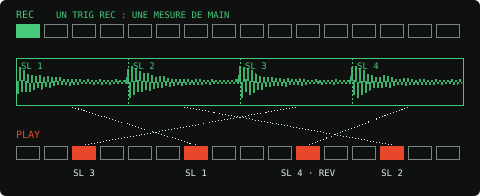

_La piste a deux couches de trigs. Les **trigs REC** (verts) lancent une prise : l'entrée, la sortie du mix ou une
autre piste (**SRC**), sur la durée de **TAKE**. Les **trigs PLAY** (rouges) la rejouent, découpée (**SLCE**),
transposée, à l'envers. Le commutateur **SIDE** choisit ce que placent les pas et ce que règlent les potards : la
lecture (PLAY), la prise (REC), ou **PRISM** (OSC, SPEC), une resynthèse spectrale de la prise._

### Les machines FX

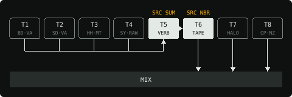

_Une piste FX passe le son d'autres pistes dans son effet, en stéréo. **SRC** choisit lesquelles : **SUM**, toutes
celles à sa gauche ; **NBR**, celle juste avant ; ou une piste au choix. Deux pistes FX à la suite font une chaîne.
Ses trigs ouvrent l'effet ou lancent son geste (geler la réverb, retourner l'écho, arrêter la bande) ; ses potards
se p-lockent comme les autres._

Les effets : **VERB** (des espaces résonants), **ECHO** (un délai à bande), **BEND** (un buffer tordu), **TAPE** (une
bande usée), **CODEC** (un codec à bas débit), **WEFT** (modulation croisée et vocodeur), **STENCIL** (un délai en
huit zones), **FUZZ** (une fuzz multibande).

## Presets et kits

Chaque machine a une vingtaine de presets d'usine (806 en tout), plus un **INIT** neutre. Leurs étiquettes disent d'où
vient l'idée : un disque, une technique, une machine. Sous l'écran, **‹ ›** passe au preset suivant ; un tap sur le nom
ouvre la liste.

- **Save** range le son de la piste parmi vos presets ; **Update**, **Rename**, **Delete** pour les vôtres.
- **☆ Default** fait d'un preset le son de départ de sa machine.
- Un **kit** (OPTION › Kits) garde les 8 sons, le master et la gamme ; avec **+ PATTERN**, la séquence aussi. Charger un
  kit sans pattern change les sons sur le même rythme.

## Façonner la piste

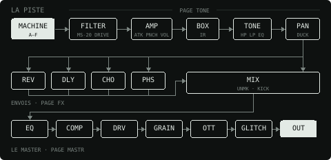

_Le son de chaque piste traverse le filtre et l'ampli de sa voix, puis la BOX, TONE et le pan, avant le mix et ses
envois. Le master le reprend ensuite._

**Page TONE**, un module à la fois sur téléphone :

- **FILTER** : un filtre de MS-20 (LP, BP, HP) ou un peigne (COMB), avec son enveloppe, du drive, du bitcrush et une
  réduction d'échantillonnage.
- **TONE** : passe-haut, passe-bas et EQ 3 bandes, propres, pour faire de la place aux autres. Sa page MORE a **SPRD**
  (la piste plus large, le centre libéré) et **MONO**. Au-dessus, le visualiseur montre le spectre de la piste et ses
  poignées règlent le filtre et l'EQ à l'œil.
- **AMP** : **VOL**, **PAN**, l'attaque (**ATK**), **PNCH** (un coup de gain sur l'attaque), **DUCK** (la piste baisse
  sous la piste 1, souvent le kick), **CURV** (la courbe de l'enveloppe), **CHOK** (les pistes d'un même groupe se
  coupent) et **DRONE**.
- **BOX** : la piste passe dans l'une de 24 réponses impulsionnelles, d'un jouet à une église.

**Page MOD** :

- **LFO 1** et **LFO 2** : vitesse (**SPD**), profondeur (**DEP**), destination (**DST**, n'importe quel réglage de la
  piste) et forme (**WAV**). Chaque forme existe aussi en **·T**, qui repart à chaque coup.
- **FOLLOWER 1** et **FOLLOWER 2** : un niveau qu'on écoute (**SRC** : la piste, une autre piste, l'entrée ou le
  master), transformé en enveloppe qui pilote un réglage. Une profondeur négative fait baisser : le kick qui creuse la
  basse, par exemple.

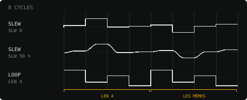

_Deux formes de LFO font de l'aléatoire musical. **SLEW** tire une valeur à chaque cycle et la rejoint en marche
(SLW 0) ou en douceur. **LOOP** tire **LEN** valeurs puis les rejoue : de l'aléatoire qui revient._

## Effets et master

**Les retours** (page FX) : chaque piste y envoie du son avec **REV**, **DLY**, **CHO** et **PHS**.

- **REVERB** : six algorithmes (ROOM, PLATE, SPRING, SPECTRAL, HALL, SPACE).
- **DELAY** : **STD**, stéréo et ping-pong, ou **1982**, un écho numérique de rack dont les répétitions glissent quand
  on change le temps.
- **CHORUS** : deux lignes à retard analogiques, quatre modes.
- **PHASER** : deux phasers à cellules photoélectriques.

**Le master** (page MASTR) : **EQ**, **COMP**, **DRV** (7 modèles), puis **GRAIN** (des textures granulaires prises dans
le mix), **OTT** (un compresseur trois bandes qui écrase et relève) et **GLITCH** (un buffer qui bégaie au tempo, de la
corruption, un codec ou une cassette). Chaque effet a sa touche **ON** ; coupé, il ne coûte plus rien. **OUT** règle la
poussée dans l'écrêteur final (**CLIP**) et le volume.

**MIX** fait de la place sans qu'on y pense : le démasquage (**UNMK**) baisse, bande par bande, une piste qui en
recouvre une autre, et **KICK** donne au kick la priorité dans le grave.

## Gamme et hasard

**Le quantizer** : touchez les notes d'une octave pour composer une gamme, ou touchez son nom pour en choisir une (MAJ,
MIN, DOR, PENT…) ; **‹ ›** la transpose. Les pistes marquées **Q** (sous les pads) y tombent, notes, locks et LFO
compris. Le quantizer peut aussi suivre les accords d'une piste HALO ou STRUM : les autres pistes jouent alors dans
l'accord du moment.

**Le hasard** :

- **Rnd · Track** tire un nouveau son pour la piste affichée ; **Rnd · All** pour toutes les pistes marquées **r** ;
  le pourcentage règle jusqu'où ; **↶** annule.
- **WTF?!** (la touche rouge au bout du groupe RND, LIVE jusqu'à la v88) bouge le son des pistes marquées **r**
  pendant qu'elles jouent, sans rien écrire : ramené au repos (double-tap), le son d'origine revient. Touchez son nom
  pour ouvrir ses réglages à la place du looper et de la gamme ; **×** les ramène.
  - **LIVE** : un nouvel écart à chaque coup.
  - **LOOMND** : à gauche du centre, une boucle de tirages qui revient tous les **LEN** pas (de 1 à 64), le même hasard
    à chaque tour ; à droite, un nouveau tirage à chaque coup ; au centre, rien. **NEW** tire une autre boucle.
  - **LFO** : une onde promène les réglages (SIN, TRI, SAW+, SAW−, SQR, S&H, SLEW, EXP). **RATE** en mesure
    (**SYNC**, du 1/16 à 16 mesures) ou en Hz (**FREE**, de 0,05 à 20 Hz) ; **RUN** tourne seul, **HIT** repart à
    chaque coup, **ONE** fait un cycle par coup puis s'arrête ; **SPRD** décale les réglages entre eux, puis en
    retourne la moitié.
- **RPAN**, **RTUN** et **RDEC** (rangée TRIG, page MORE) tirent le pan, la hauteur et le decay de chaque coup.

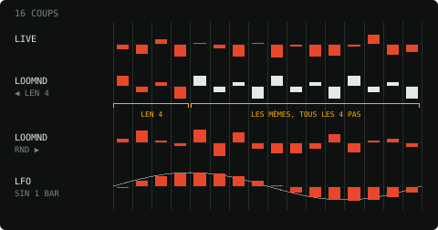

_Seize coups d'une piste marquée **r**. **LIVE** et **LOOMND** à droite tirent un nouvel écart à chaque coup ;
**LOOMND** à gauche rejoue la même boucle tous les **LEN** pas ; le **LFO** fait suivre aux coups une onde, ici un sinus
d'une mesure en RUN._

## Dans le DAW

- La séquence suit le transport et le tempo de l'hôte ; ▶ lance l'horloge interne quand l'hôte est à l'arrêt.
- **MIDI** : sur le canal 1, les notes 36 à 43 (C1 à G1) déclenchent les pistes 1 à 8. Les canaux 2 à 9 jouent les
  pistes 1 à 8 au clavier, do4 à leur hauteur.
- L'entrée stéréo du plugin est la source **IN** de RAM (une side-chain dans Logic).
- Le projet garde le motif, les sons, les locks et les prises de RAM. Les sons de CHIMERA sont installés à part, un
  seul exemplaire pour le VST3, l'AU et l'application.
- **Mises à jour** : IMPAKT signale une nouvelle version une fois par session ; **OPTION › Updates** la télécharge. Voir
  [Installer](https://distortedimages-code.github.io/IMPAKT/install.html).

## Compiler le plugin

Il faut CMake 3.22 ou plus ; JUCE est téléchargé tout seul.

```sh
cd plugin
cmake -B build -DCMAKE_BUILD_TYPE=Release
cmake --build build --config Release
```

Sur Mac, **build_mac.command** fait tout (compiler, installer, valider l'AU). Windows demande clang-cl et le paquet
WebView2, Linux WebKitGTK 4.1 et libcurl : les détails sont dans la
[référence](reference.md#compiler-le-plugin). L'interface se reconstruit avec `python3 tools/build_web.py`.

## Licences

IMPAKT est un logiciel libre, sous licence **GNU GPL v3** (`LICENSE`). Il est construit avec **JUCE**, utilisé sous
AGPLv3. Le code repris d'ailleurs garde sa licence :

- **Mutable Instruments** (Plaits, Beads, Warps, Streams, stmlib ; MIT, © Emilie Gillet) : MACRO, GRAIN, WEFT et la
  courbe CURV, dans `core/mi/`. Les voix six-op fournies avec Plaits viennent de banques DX7 que la licence du code
  ne couvre pas forcément.
- **BYOD** (ChowDSP, Jatin Chowdhury ; GPL-3) : le ressort de WEST, `core/LICENSE-BYOD.txt`.
- **EaseLFO** (Laboratoire Formes·Ondes ; BSD 3 clauses) : le patch de WEST, `core/LICENSE-EaseLFO.txt`, dont la
  notice suit.
- **minimp3** (lieff ; domaine public, CC0) : le décodage MP3 de RADIO.
- Les polices Big Shoulders Display, Martian Mono, Saira, Silkscreen et Sofia Sans Extra Condensed sont sous SIL Open
  Font License (`web/fonts/`).

Les autres machines et effets qui rendent hommage à des instruments (réverbs, delays, chorus, phaser, fuzz, tables
d'ondes, drone) sont écrits ici, d'après ce qui en est publié : aucun code ni micrologiciel de leurs fabricants n'y
figure, et leurs noms, qui sont des marques de leurs propriétaires, n'apparaissent pas dans l'interface. La banque de
CHIMERA vient d'un kit libre d'utilisation, inspiré de SOPHIE. Le détail, source par source, est dans la
[référence](reference.md#licences).

<details>
<summary>Notice d'EaseLFO</summary>
<p>Copyright (c) 2023, Laboratoire Formes·Ondes</p>
<p>Redistribution and use in source and binary forms, with or without modification, are permitted provided that the following conditions are met: 1. Redistributions of source code must retain the above copyright notice, this list of conditions and the following disclaimer. 2. Redistributions in binary form must reproduce the above copyright notice, this list of conditions and the following disclaimer in the documentation and/or other materials provided with the distribution. 3. Neither the name of the copyright holder nor the names of its contributors may be used to endorse or promote products derived from this software without specific prior written permission.</p>
<p>THIS SOFTWARE IS PROVIDED BY THE COPYRIGHT HOLDERS AND CONTRIBUTORS "AS IS" AND ANY EXPRESS OR IMPLIED WARRANTIES, INCLUDING, BUT NOT LIMITED TO, THE IMPLIED WARRANTIES OF MERCHANTABILITY AND FITNESS FOR A PARTICULAR PURPOSE ARE DISCLAIMED. IN NO EVENT SHALL THE COPYRIGHT HOLDER OR CONTRIBUTORS BE LIABLE FOR ANY DIRECT, INDIRECT, INCIDENTAL, SPECIAL, EXEMPLARY, OR CONSEQUENTIAL DAMAGES (INCLUDING, BUT NOT LIMITED TO, PROCUREMENT OF SUBSTITUTE GOODS OR SERVICES; LOSS OF USE, DATA, OR PROFITS; OR BUSINESS INTERRUPTION) HOWEVER CAUSED AND ON ANY THEORY OF LIABILITY, WHETHER IN CONTRACT, STRICT LIABILITY, OR TORT (INCLUDING NEGLIGENCE OR OTHERWISE) ARISING IN ANY WAY OUT OF THE USE OF THIS SOFTWARE, EVEN IF ADVISED OF THE POSSIBILITY OF SUCH DAMAGE.</p>
</details>
